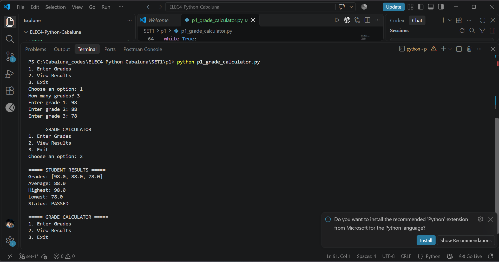
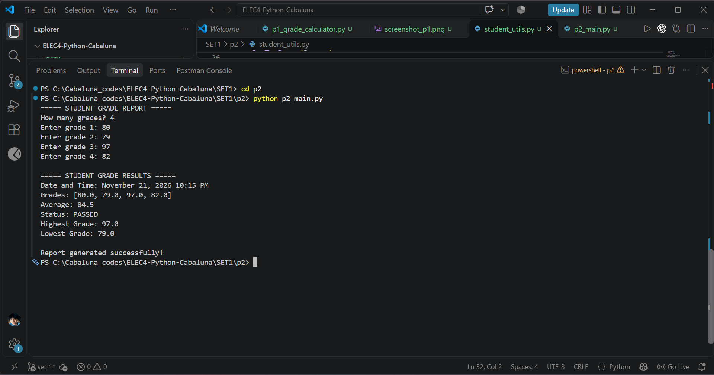
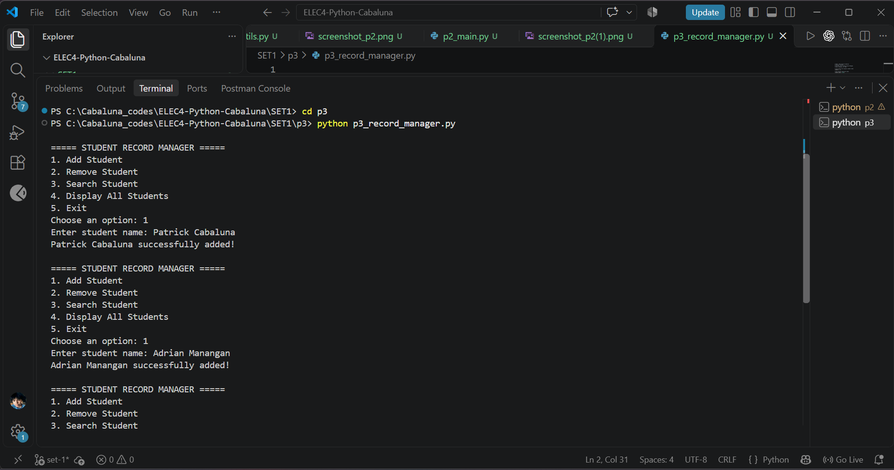
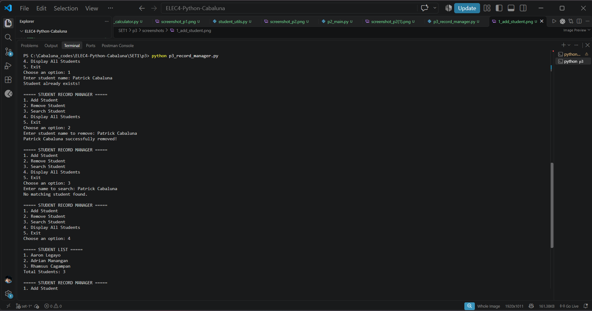

# ELEC 4 – Python Programming

**Student Name:** [Your Full Name]  
**Section:** IV-BSIT [Your Section]  
**Course:** ELEC 4 – Python Programming  
**Set:** Set 1  
**Academic Year:** 2026

---

## About This Repository

This repository contains my Python Programming activities for ELEC 4. It demonstrates my understanding of Python functions, modules, lists, sets, and exception handling.

## Set 1 – Python Activities

| Activity | Description | Folder |
|---|---|---|
| P1 – Student Grade Calculator | Uses functions to calculate student grades, average, highest, lowest, and pass/fail status. | [P1 Folder](set1/p1/) |
| P2 – Custom Module | Uses a custom Python module to calculate grades and generate a student report. | [P2 Folder](set1/p2/) |
| P3 – Student Record Manager | Manages student names using lists and sets. Supports adding, removing, searching, and displaying students. | [P3 Folder](set1/p3/) |
| P4 – Safe Menu Program | Demonstrates exception handling using try, except, else, and finally. | [P4 Folder](set1/p4/) |

---

## How to Run the Programs

Make sure Python is installed on your computer.

Check your Python version:

```bash
python --version
```

### P1 – Student Grade Calculator

**File:** `p1_grade_calculator.py`

Run:

```bash
python set1/p1/p1_grade_calculator.py
```

### P2 – Custom Module

**Files:**
- `student_utils.py`
- `p2_main.py`

Run:

```bash
python set1/p2/p2_main.py
```

### P3 – Student Record Manager

**File:** `p3_record_manager.py`

Run:

```bash
python set1/p3/p3_record_manager.py
```

### P4 – Safe Menu Program

**File:** `p4_exceptions.py`

Run:

```bash
python set1/p4/p4_exceptions.py
```

---

## Screenshots

Screenshots of the actual program outputs are saved in the screenshots folder of each activity.

### P1 – Student Grade Calculator



### P2 – Custom Module



.png)

### P3 – Student Record Manager





### P4 – Safe Menu Program


---

## Technologies Used

- Python
- VSCodium
- Git
- GitHub

## Learning Objectives

Through these activities, I learned how to:

1. Create and use user-defined functions.
2. Create and import custom Python modules.
3. Work with lists and sets.
4. Handle errors and exceptions.
5. Organize and manage Python projects.
6. Use Git and GitHub to manage source code.

---

**ELEC 4 – Python Programming**  
College of Computing Sciences  
Information Technology Department